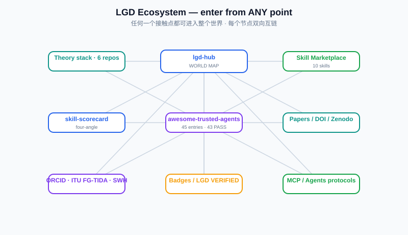

## World Map / 世界地图（任何一个入口 = 进入整个世界）

> **Enter through ANY asset — a skill, a paper, a badge, an MCP, a list — and you reach the whole LGD world.**
> **从任意一个资产进入（技能/论文/徽章/MCP/榜单），就抵达整个 LGD 世界。**

### 1. Theory / 理论
- [lgd-theory](https://github.com/zhaoxinghua09-cell/lgd-theory) — LGD 三律理论本体
- [theoriturgy](https://github.com/zhaoxinghua09-cell/theoriturgy) — 三律实践方法论
- [uibc-core](https://github.com/zhaoxinghua09-cell/uibc-core) — UIBC 治理理论核心
- [xlgd](https://github.com/zhaoxinghua09-cell/xlgd) — 扩展治理论
- 17 术语体系（Zenodo [LGD Term Registry v1.0](https://doi.org/10.5281/zenodo.23385209)，17 个术语逐条有定义与查重记录）：
  - 12 个 `-urgy` 创造工程术：**theoriturgy** / standardurgy / skillurgy / benchmarkurgy / researchurgy / eureurgy / analogurgy / referurgy / synthesurgy / holurgy / ideurgy / brainstormurgy
  - 2 个 `-ship` 治理线：symbioship / genoship
  - 价值基座：axiurgy　·　L4 顶梁：self-hosting-closure　·　执行层：placeholdurgy
- [silent-failure-catalog](https://github.com/zhaoxinghua09-cell/silent-failure-catalog) — 静默失败分类目录
- [assayance](https://github.com/zhaoxinghua09-cell/assayance) — 试真法 / 可证伪保证（Assayance）

### 2. Skills / 技能超市（进一个 = 开全店）
- [lgd-skill-marketplace](https://github.com/zhaoxinghua09-cell/lgd-skill-marketplace) — 技能超市总目录（10 技能）
- 技能全家桶：skill-skeleton-generator / prompt-injection-guard / context-token-budget / silent-failure-scanner / badge-studio / llms-generator / skill-quality-gate / skill-registry / skill-scorecard / lgd-guardrails

### 3. Lists & Scoring / 榜单与评分
- [awesome-trusted-agents](https://github.com/zhaoxinghua09-cell/awesome-trusted-agents) — 四角度评分精选清单（**首批 45 条目，43 条通过**；评分为公开资料初评，正式收录前逐条复核）
- [skill-scorecard](https://github.com/zhaoxinghua09-cell/skill-scorecard) — 四角度评分引擎（REG/TRUST/SAFE/MACH）

### 4. Standards & Identity / 标准与身份
- **ITU-T FG-TIDA**：[github.com/FG-TIDA](https://github.com/FG-TIDA) — 国际标准论坛参与（理论贡献）
- **ORCID**：[0009-0001-0512-1237](https://orcid.org/0009-0001-0512-1237)
- **Zenodo**：[DOI 10.5281/zenodo.23385209](https://doi.org/10.5281/zenodo.23385209)
- **Software Heritage**：[archive.softwareheritage.org](https://archive.softwareheritage.org/browse/origin/?origin_url=https%3A%2F%2Fgithub.com%2Fzhaoxinghua09-cell%2Flgd-hub) — 已归档（visit 1 / full / 2026-10-15，SWHID `swh:1:snp:c3fb183c…`）

### 5. Verify it yourself / 自己验

> 本节列出的每一项都能独立复核。归档类证据的含义是「该内容在某个快照里以此哈希存在过」，**不是**可用性承诺——按 SWHID 规范，origin 可能变更或消失。

| 可验什么 | 怎么验 | 入口 |
|---|---|---|
| 151 项测试真能跑 | 零依赖，单条命令 | [uibc-core](https://github.com/zhaoxinghua09-cell/uibc-core)（代码 Apache-2.0；理论文本 ARR，见该仓 NOTICE.md）· `python -m unittest discover -s tests` |
| 理论全文是否真公开 | 直接读 | [lgd-theory](https://github.com/zhaoxinghua09-cell/lgd-theory) |
| 14 个静默失效模式 | SF-001…SF-014 逐条有判据 | [silent-failure-catalog](https://github.com/zhaoxinghua09-cell/silent-failure-catalog) |
| 内容是否被第三方存档 | 查归档快照（SWHID） | [SWH: lgd-theory](https://archive.softwareheritage.org/browse/origin/directory/?origin_url=https%3A%2F%2Fgithub.com%2Fzhaoxinghua09-cell%2Flgd-theory%2F) · [SWH: uibc-core](https://archive.softwareheritage.org/browse/origin/directory/?origin_url=https%3A%2F%2Fgithub.com%2Fzhaoxinghua09-cell%2Fuibc-core%2F) |
| **uibc-core v0.2.1 的 zip** 摘要是否进透明日志 | 查 logIndex 并比对 sha256 `59cc1c91…` | [Rekor `2883389783`](https://search.sigstore.dev/?logIndex=2883389783)（本仓自身没有签名产物，主语不是「本仓发布件」） |
| 各处许可到底是什么 | 逐仓读 LICENSE | 见 [NOTICE.md](NOTICE.md) 的分层许可表（13 个仓逐个核过）——**本生态是分层许可，不是统一开源，也不都是 ARR** |
| 怎么参与 | 公开 issue / PR | [LGD 主仓](https://github.com/zhaoxinghua09-cell/LGD)（Apache-2.0） |

### 6. Papers / 论文
- 已发表论文均在 Zenodo 公开登记，可按作者主体直接检索，无需向我们索取清单：
  - 理论主线（concept DOI）：[10.5281/zenodo.22456647](https://doi.org/10.5281/zenodo.22456647) —— 当前版本 v1.7.0
  - 术语注册：[10.5281/zenodo.23385209](https://doi.org/10.5281/zenodo.23385209) —— LGD Term Registry v1.0
  - 作者标识：[ORCID 0009-0001-0512-1237](https://orcid.org/0009-0001-0512-1237)（该 ORCID 下的全部记录）

### 7. AI Agent Entry Points / AI 代理入口
- 本枢纽仓五件齐备：`llms.txt` / `AGENTS.md` / `CITATION.cff` / `codemeta.json` / `agents.txt`
- 兄弟仓以各自仓内的 `llms.txt` 为准；五件套按本仓范式逐步补齐，**未补齐的不替它宣称**
- 路由规则：AI 从任意资产进入 → 读该仓 `llms.txt` → 到达本世界地图（`world.json`）→ 全资产可发现
- 本仓 `llms.txt` 与 `world.json` 是**描述性索引**，不是实体归一（entity resolution）指令，见上方「身份分层声明」

---
## 联系 / Contact

- 标准与学术事务：`zhaoxinghua09@gmail.com`
- 其他公开事务：`zhaoxinghua06@126.com`
- 公开标准组织列表通信使用 W3C / ITU 注册邮箱（见各组织归档）
- 身份：赵兴华 / Xinghua Zhao · 独立研究者 · [ORCID 0009-0001-0512-1237](https://orcid.org/0009-0001-0512-1237)
- 参与：公开 issue / PR（[贡献入口](https://github.com/zhaoxinghua09-cell/LGD)，Apache-2.0）

## 许可说明 · License Notice

> **本仓库使用自定义许可，不是 MIT / Apache-2.0**。平台显示为 `Other`（NOASSERTION），
> 属识别算法的正常结果，**不代表本仓库处于无许可状态**。

- **权利状态**：全部内容保留所有权利（All Rights Reserved）。未经书面许可，
  不得复制、改编、再分发、公开传播或用于衍生作品。
- **可否引用**：可以。允许在**注明出处**的前提下引用与学术、公共讨论；
  引用时请同时标注仓库名、原文链接 `https://github.com/zhaoxinghua09-cell/lgd-hub`
  与权利人「赵兴华 / Steven Zhao·China」。
- **完整条款**：见仓库根目录 [LICENSE](LICENSE)。
- **联系**：zhaoxinghua06@126.com ｜ ORCID 0009-0001-0512-1237
- **品牌状态限定**：MedXpert、SynomosAI、LGD 等为相关项目标识，
  **均未申请实体注册、未申请商标注册**；出现仅作来源标识，
  不构成对法人实体或商标权的任何主张。
- **免责**：本仓库内容不构成法规意见或注册代理服务；关键数据以监管机构最新发布为准。

---

*World Map generated 2026-10-15 · 最近复核 2026-10-22：本页 GitHub 类外链逐条实测 200；DOI/Zenodo 在本机网络下不可达，改用 DataCite 元数据与 doi.org 302 侧证（**本机不可达 ≠ 链接失效**）。许可已逐仓读 LICENSE 核对，见 [NOTICE.md](NOTICE.md) 的分层许可表。*
